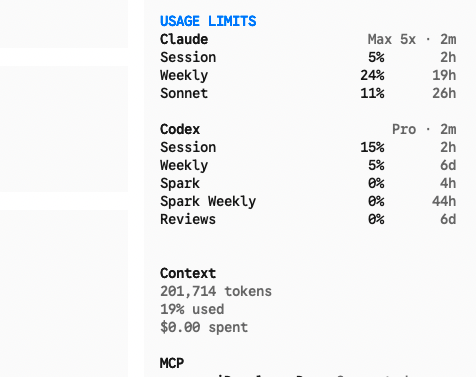

# OpenCode Limits Sidebar Plugin

A small OpenCode plugin that mirrors your local `openusage` limits into a compact sidebar table.

Yep, this thing was vibe coded. I've only tested it on macOS so far.



If the layout looks a little rough around the edges, that's because I'm not some elite TUI UI designer. PRs, cleanup requests, and design suggestions are all welcome.

## Prerequisites

1.  **OpenCode**: Version `>= 2.0`. For OpenCode 1.x, use commit `09f7f69` of this repo.
2.  **OpenUsage**: You need [OpenUsage](https://github.com/robinebers/openusage) running locally. The plugin polls `http://127.0.0.1:6736/v1/usage` directly.

## Why It Has No Options

This plugin is meant to mirror whatever your current `openusage` setup already exposes.

So it doesn't add its own config surface, mapping rules, or provider-specific settings. If `openusage` changes, the sidebar should change with it. The whole point is that you shouldn't have to configure the same thing twice.

## Installation

This is a CLI-only plugin. OpenCode 2 automatically discovers plugin directories under `~/.config/opencode/plugins/`, and it compiles the TSX source itself. So you don't need a build step, `npm install`, or a config entry.

Clone the repo into the global plugins directory:

```bash
mkdir -p ~/.config/opencode/plugins
gh repo clone hkay-dev/opencode-limits-sidebar ~/.config/opencode/plugins/opencode-limits-sidebar
```

Restart OpenCode to load it.

To update it later:

```bash
cd ~/.config/opencode/plugins/opencode-limits-sidebar
git pull --ff-only
```

If you'd rather keep the checkout somewhere else, add its path to `plugins` in `~/.config/opencode/cli.json`:

```json
{
  "plugins": ["/path/to/opencode-limits-sidebar"]
}
```

### Upgrading from the OpenCode 1.x version

The 1.x plugin entrypoints don't run in OpenCode 2. After pulling, you can delete the old `dist/` and `node_modules/` directories from the checkout. If you added the plugin to `tui.json` or `opencode.json` with `opencode plugin ... -g`, remove that entry. Discovery from the plugins directory replaces it.

## Tell Your Agent

```text
Install the OpenCode Limits Sidebar plugin for OpenCode 2. Use `~/.config/opencode/plugins/opencode-limits-sidebar` as the checkout path. If the repo isn't there yet, create `~/.config/opencode/plugins` and clone `hkay-dev/opencode-limits-sidebar` there with `gh repo clone`. If it's already there, run `git pull --ff-only` in that directory. No build or config change is needed; OpenCode discovers it automatically on restart.
```

## Usage

Open a session in OpenCode and you'll see `USAGE LIMITS` in the right-hand sidebar below the built-in sections. The sidebar shows automatically when the terminal is wider than 120 columns. Otherwise, toggle it from the command palette.

## Development

```bash
npm install
npm test   # typecheck + unit tests
```

`tui.ts` is the entrypoint that OpenCode discovers. The plugin itself lives in `src/tui.tsx`.

The sidebar shows provider name, plan, last update time, percentage usage, and reset timing for percentage-based limits. It polls `openusage` every 30 seconds.

## Notes

- I've only tested it on macOS.
- If you want Linux or Windows polish, send a PR.
- If you want the table styling cleaned up, send a PR or open an issue. I'm very open to better ideas here.
- If your `openusage` setup is weird, this plugin will probably show that weirdness pretty honestly.

## License

MIT. Fork it, tweak it, and ship your own version.
